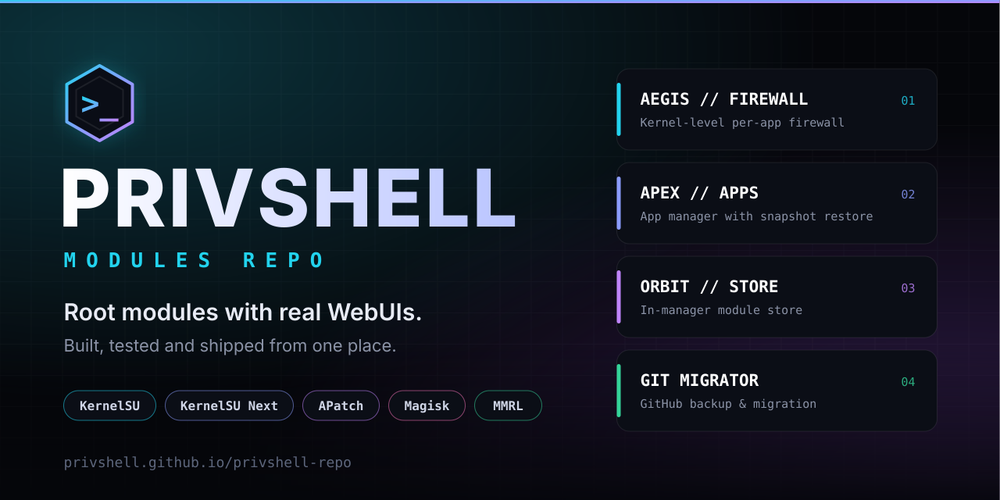

<div align="center">



[](https://privshell.github.io/privshell-repo/)
[](docs/INSTALL.md)
[](docs/INSTALL.md)
[](docs/INSTALL.md)
[](LICENSE)

**Root modules with real WebUIs — built, tested and shipped from one place.**

[Website](https://privshell.github.io/privshell-repo/) · [Install guide](docs/INSTALL.md) · [Report an issue](https://github.com/privshell/privshell-repo/issues/new/choose)

</div>

---

## Add this repository

Open **MMRL** (Magisk Module Repo Loader), go to the repositories screen and add the following URL. Any root manager that supports custom module repositories can use the same address.

```
https://privshell.github.io/privshell-repo/json/modules.json
```

Once the repository is added, every module below appears in the module list and can be installed and updated from the app. Step-by-step instructions for each root manager are in the [install guide](docs/INSTALL.md).

## Modules

| Module | What it does | Docs |
| --- | --- | --- |
| **AEGIS // FIREWALL** | Kernel-level per-app firewall with a WebUI. Separate rules for Wi-Fi, mobile data, VPN, LAN and roaming, per-app host rules, screen-off blocking and a live connections view. | [Read more](docs/aegis-firewall.md) |
| **APEX // APPS** | App manager with a WebUI. Review and disable preinstalled apps with snapshot restore, freeze apps, control background permissions, back up app data and tune battery policy. | [Read more](docs/apex-apps.md) |
| **ORBIT // STORE** | In-manager module store. Browse, install and update modules from modules.kernelsu.org with sha256 verification, directly inside your root manager's WebUI. | [Read more](docs/orbit-store.md) |
| **Git Migrator** | AMOLED WebUI to back up GitHub repositories, move them with all branches, tags and history to a new account, upload folders and fix old-username links. Requires Termux with git and python. | [Read more](docs/git-migrator.md) |

## Compatibility

| Root solution | Module install | WebUI |
| --- | --- | --- |
| KernelSU / KernelSU Next | Supported | Built in |
| APatch | Supported | Built in |
| Magisk | Supported | Through a WebUI-capable app such as MMRL |

Details and troubleshooting tips are in the [install guide](docs/INSTALL.md).

## Repository layout

```
.
├── assets/        Banner, logo and other static images
├── docs/          Install guide and one page per module
├── json/          Repository index consumed by MMRL (modules.json)
├── modules/       Module sources and packaged releases
├── .github/       Issue forms, pull request template and workflows
├── index.html     Landing page served by GitHub Pages
├── CONTRIBUTING.md
├── SECURITY.md
└── LICENSE
```

## Support

- **Bugs and feature requests:** use the [issue forms](https://github.com/privshell/privshell-repo/issues/new/choose). Include the module name, its version, your root solution and Android version.
- **Contributing:** see [CONTRIBUTING.md](CONTRIBUTING.md).
- **Security reports:** see [SECURITY.md](SECURITY.md). Please do not open public issues for vulnerabilities.

## Links

- Source and issues: [github.com/privshell](https://github.com/privshell)
- More projects: [privshell-repo](https://github.com/privshell/privshell-repo)

## License

The repository index, website and tooling are released under the [GPL-3.0 License](LICENSE). Modules are MIT licensed unless stated otherwise in their own source.
